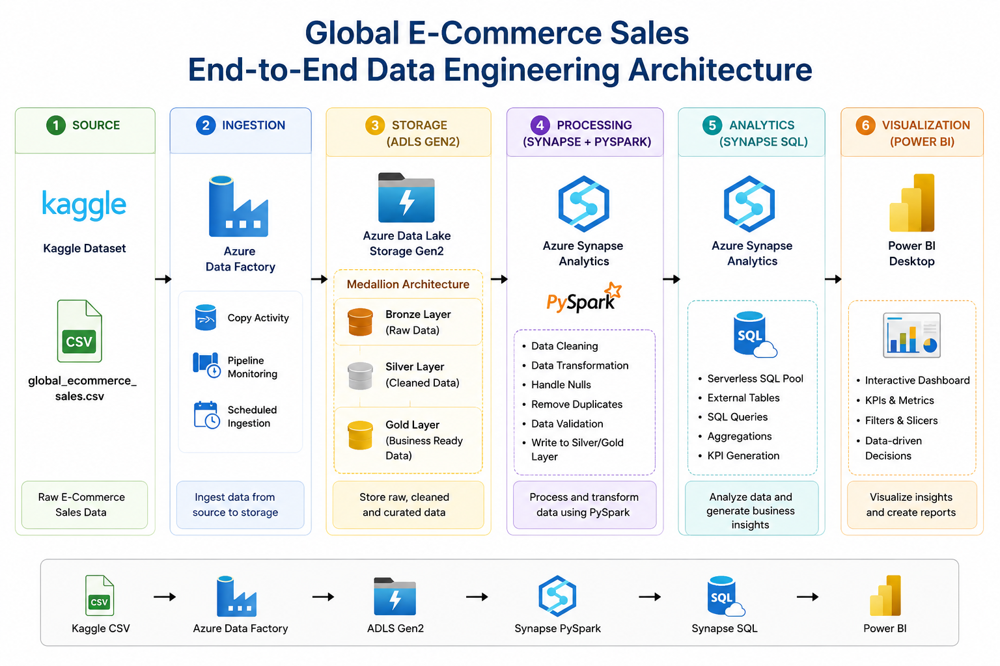

# Global E-Commerce Sales Data Pipeline on Azure

An Azure data engineering project that ingests e-commerce sales CSV files, cleans and transforms them with **Azure Synapse PySpark**, stores the cleaned dataset as **Parquet in Azure Data Lake Storage Gen2 (ADLS Gen2)**, and queries it with **Synapse Serverless SQL**.

> **Repository naming note:** This repository's current name is `Customer_Account_Analysis_Pipeline_Shahina`, but the notebook, source fields, and SQL scripts in the repository implement a global e-commerce sales workflow. This README describes the code that is actually included.

## Project at a glance

- **Goal:** Prepare raw e-commerce sales data for SQL-based analysis.
- **Ingestion/orchestration:** Azure Data Factory (ADF).
- **Storage:** Azure Data Lake Storage Gen2.
- **Transformation:** Azure Synapse PySpark notebook.
- **Analytics:** Azure Synapse Serverless SQL.
- **Output:** Cleaned Parquet files and SQL queries for sales analysis.

## Architecture



**High-level flow**

`Source CSV files → Azure Data Factory → ADLS Gen2 → Synapse PySpark → Cleaned Parquet → Synapse Serverless SQL`

The repository includes Azure setup and execution screenshots in the [Screenshots folder](Screenshots/).

## Data workflow

1. **Read source files** — the notebook reads CSV files from the configured ADLS Gen2 path.
2. **Remove duplicate rows** — applies PySpark `dropDuplicates()`.
3. **Handle missing values** — applies `dropna()`, which drops a row if any column is null.
4. **Standardize dates** — when `Transaction Date` is present, creates `Transaction_Date`, `Transaction_Month`, and `Transaction_Year`.
5. **Cast numeric fields** — when present, casts `Price` to double and `Quantity` to integer.
6. **Derive revenue** — when both fields exist, creates `Revenue = Price × Quantity`.
7. **Write cleaned data** — writes Parquet files to the configured `cleaned/ecommerce_cleaned` output path.
8. **Query for insights** — SQL scripts preview the output and summarize total records, revenue by region and category, and top products.

**Data-quality note:** The current notebook removes rows with any null value and removes exact duplicate rows. For production use, consider adding explicit required-column checks, rejected-row reporting, schema enforcement, and before/after quality metrics. See the [Data Quality and Validation Report](Documentation/Step_10_Data_Quality_and_Validation.md) for the current behavior, gaps, and a repeatable validation checklist.

## Repository structure

```text
.
├── Code/
│   ├── ecommerce_data_cleaning.ipynb
│   ├── external_data_source_setup.sql
│   └── sql_analytics.sql
├── Documentation/
│   ├── Step_1_Project_Documentation.docx
│   ├── Step_2_Architecture_Diagram.png
│   ├── Step_9_Submission_Checklist.md
│   └── Step_10_Data_Quality_and_Validation.md
├── Screenshots/
│   ├── Azure Storage account and container setup
│   ├── ADF pipeline and successful debug run
│   ├── Synapse data explorer and SQL results
│   └── access configuration and PySpark execution
└── README.md
```

- [PySpark cleaning notebook](Code/ecommerce_data_cleaning.ipynb)
- [External data source and view setup](Code/external_data_source_setup.sql)
- [SQL analytics examples](Code/sql_analytics.sql)
- [Architecture diagram](Documentation/Step_2_Architecture_Diagram.png)
- [Project documentation](Documentation/Step_1_Project_Documentation.docx)
- [Submission checklist and scope notes](Documentation/Step_9_Submission_Checklist.md)
- [Data quality and validation report](Documentation/Step_10_Data_Quality_and_Validation.md)

## Prerequisites

You need access to an Azure subscription and the required permissions for the services you use.

- Azure Data Lake Storage Gen2 storage account and container.
- Azure Data Factory instance and a configured pipeline for source-file movement/orchestration.
- Azure Synapse workspace with a PySpark-capable Spark pool and Serverless SQL endpoint.
- CSV source data containing the fields used by the queries, such as `Price`, `Quantity`, `Region`, `Category`, and `Product`.
- Appropriate Azure role assignments and SQL permissions to read the storage location.

Azure service availability, networking, role assignments, and billing depend on your subscription and configuration.

## Run the project

### 1. Configure your storage paths

Before running the notebook or SQL scripts, open the files and replace the existing environment-specific storage account and container paths with your own:

- `Code/ecommerce_data_cleaning.ipynb` — update `input_path`, `output_path`, and the optional `powerbi_output_path`.
- `Code/external_data_source_setup.sql` — update the `LOCATION` for `EcommerceLake` and the output folder used by the SQL queries.
- `Code/sql_analytics.sql` — confirm the configured data source and relative folder path match the Parquet output.

The supplied notebook currently expects source CSV files under `global E commerce sales dataset/` and writes cleaned Parquet data under `cleaned/ecommerce_cleaned/`.

### 2. Ingest the source data

Upload the source CSV files to the configured container and set up or open the Azure Data Factory pipeline to copy the files to the expected storage location. The repository's screenshots document the ADF setup and debug run.

### 3. Execute the PySpark notebook

Open `Code/ecommerce_data_cleaning.ipynb` in the Synapse workspace, select the appropriate Spark pool, verify the paths and permissions, and run the cells. Review the initial and cleaned row counts and inspect sample output before proceeding.

### 4. Configure Serverless SQL access

Open `Code/external_data_source_setup.sql` in the Synapse SQL environment. Select or create the `ecommerce_db` database as appropriate, update the external data source location, and run the statements with an identity that has the required access.

The optional SAS credential is commented out in the script. Prefer managed identity and Azure role-based access where possible; never commit account keys, passwords, or SAS tokens to this repository.

### 5. Run the analytics queries

Run `Code/sql_analytics.sql` after confirming that the external data source points to the cleaned Parquet output. The included queries demonstrate:

- Previewing cleaned records and counting rows.
- Calculating total revenue as `Price × Quantity`.
- Summarizing revenue by region and category.
- Ranking products by revenue and quantity.

## Validation checklist

Use this checklist after an execution:

- [ ] Confirm the source files are available at the configured input path.
- [ ] Review source and cleaned row counts in the notebook output.
- [ ] Inspect sample cleaned records and confirm the expected columns exist.
- [ ] Check date conversion and numeric casts for unexpected nulls.
- [ ] Confirm Parquet files were written to the expected output folder.
- [ ] Confirm Serverless SQL can read the Parquet files.
- [ ] Run each analytics query and inspect the result set.
- [ ] Verify that access is granted through appropriate permissions and no credentials are committed.

These are recommended manual validation steps; the repository does not currently include a separate automated test suite.

## Screenshots

The repository includes screenshots of the storage account/container setup, ADF pipeline, successful ADF debug run, Synapse Data Explorer, SQL query execution, and access configuration.

- [View ADF pipeline](Screenshots/Step_3_Screenshot_1_ADF_Pipeline.png)
- [View successful ADF debug run](Screenshots/Step_4_Screenshot_1_ADF_Debug_Succeeded.png)
- [View Synapse Data Explorer](Screenshots/Step_5_Screenshot_1_Synapse_Data_Explorer.png)
- [View SQL query execution](Screenshots/Step_6_Screenshot_1_SQL_Query_Working.png)
- [View PySpark execution screenshot](Screenshots/Step_8_Screenshot_1_PySpark_Execution.png.png)

## Scope and possible next improvements

The submitted workflow ends with SQL analytics. The project checklist notes that Power BI integration was attempted but is not part of the final scope.

Potential follow-on improvements:
- Parameterize storage paths instead of editing notebook code for each environment.
- Add explicit schema validation and data-quality summary metrics.
- Report malformed or rejected records instead of silently dropping all rows containing nulls.
- Add repeatable test cases for cleaning rules and revenue calculations.
- Document a small, non-sensitive sample input and expected output.
- Consider renaming the GitHub repository so its name matches the e-commerce project.

## Author

**Shahina Shaik** — Data Engineering

- [GitHub profile](https://github.com/shahinashiny)
- [LinkedIn](https://www.linkedin.com/in/shahina-shaik-8ba21a24a)
- [Portfolio](https://benevolent-wisp-556282.netlify.app/)
